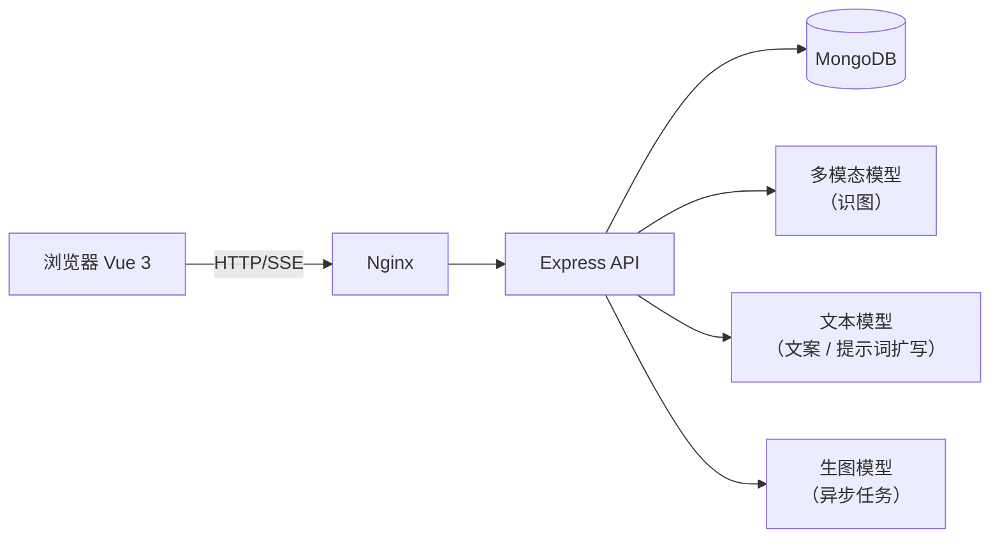

# 全栈开发实施方案

**多模态 AI 跨境电商智能出海营销工坊**


## 一、项目背景与开发目标

针对中国企业品牌出海、跨境独立站与海外社媒投放的痛点，本项目由学生**独立全栈**构建一款集“商品视觉理解、多语言爆款文案生成、AI 场景生图、社媒营销资源打包”于一体的智能营销 SaaS 系统。

学生是整个项目的主导者，要从 0 到 1 走完需求设计、前后端编码、AI 大模型集成、云端容器化部署的全过程，以此考核全栈开发与 AI 应用落地能力。


### 1.1 行业痛点与系统对应能力

| **出海营销痛点** | **具体表现**                               | **本系统的解决思路**                           |
| ---------------- | ------------------------------------------ | ---------------------------------------------- |
| 不会“看”商品     | 运营要人工总结外观与卖点，效率低、口径不一 | 多模态大模型读图，输出结构化卖点 JSON          |
| 多语言文案成本高 | 每个语种、每个平台都要找人写，调性还不同   | Prompt 模板引擎 + 文本大模型，按语言和渠道生成 |
| 场景图制作贵     | 海外生活场景图要请摄影师或设计师           | 卖点转英文提示词，调用生图大模型生成场景主图   |
| 素材分散难交付   | 图片、文案散落在各处，投放前要手工整理     | 一键打包 ZIP 营销包                            |
| AI 成本不透明    | 不知道每天花了多少 Token、调用成不成功     | Token 审计与运营数据看板                       |

### 1.2 开发目标

学完本周，每位同学要交付一套能在公网访问的完整系统，并且能走通下面这条链路：

**商品图片上传 → AI 识别外观与卖点 → 多语言多渠道文案（流式生成）→ AI 场景主图 → 一键导出 ZIP 营销包 → 查看 Token 消耗看板 → Docker 部署上线**


## 二、核心技术底座

| **层次**         | **技术选型**                                       | **说明**                                                     |
| ---------------- | -------------------------------------------------- | ------------------------------------------------------------ |
| 前端 Web Client  | Vue 3 + Vite + Element Plus + Pinia + ECharts      | 组件化界面、状态管理、数据看板                               |
| 后端 API Service | Node.js + Express（也可用 Spring Boot）            | RESTful API，并用 SSE 做流式推送；作业中的代码示例以 Express 为准 |
| 数据库           | MongoDB（Mongoose）                                | 存商品资产、营销文案/图片、Token 账单                        |
| 多模态大模型     | 通义千问 Qwen-VL（或 GPT-4o Vision）               | 解析商品外观与核心卖点                                       |
| 文本大模型       | 通义千问 Qwen-Plus（或其他兼容 OpenAI 协议的模型） | 多语言文案生成、生图提示词扩写                               |
| 生图大模型       | 通义万相（阿里云百炼）                             | 异步任务方式生成海外场景商品主图                             |
| 云原生部署       | Linux 云服务器 + Docker + Docker Compose + Nginx   | 容器化打包、服务编排、反向代理                               |

**说明：**为了让一个 API Key 就能打通“识图、写文案、生图”三个能力，作业示例统一使用**阿里云百炼（DashScope）**。如果有其他模型额度，也可以替换，但**必须使用环境变量配置**，不能把 Key 写进代码。


## 三、系统功能模块与总体架构

### 3.1 功能模块

| **模块**   | **主要功能**                                             | **对应作业**     |
| ---------- | -------------------------------------------------------- | ---------------- |
| 资产中心   | 商品多图上传、信息录入、瀑布流列表                       | 作业 3           |
| 视觉理解   | 调用多模态模型，提取外观、卖点、场景建议                 | 作业 4           |
| 文案引擎   | 按语言与渠道生成文案，敏感词拦截，SSE 流式输出，文案管理 | 作业 5、6        |
| 场景生图   | 提示词扩写、异步生图、前端轮询、结果展示                 | 作业 7           |
| 导出与看板 | ZIP 营销包、Token 埋点、ECharts 运营看板                 | 作业 8           |
| 工程与部署 | 脚手架、数据库建模、Docker 化、云端发布、归档            | 作业 1、2、9、10 |

### 3.2 数据流转



### 3.3 项目目录约定

```text
ai-marketing-workshop/
├─ client/          # Vue 3 前端
│  ├─ src/{api,components,views,stores,utils}
│  ├─ .env.development
│  ├─ .env.production
│  ├─ nginx.conf
│  └─ Dockerfile
├─ server/          # Express 后端
│  ├─ src/{config,routes,controllers,services,models,middlewares,utils}
│  ├─ uploads/        # 上传与生成的图片（不进 Git）
│  ├─ .env          # 密钥（不进 Git）
│  ├─ .env.example
│  └─ Dockerfile
├─ docker-compose.yml
├─ .gitignore
└─ README.md
```


## 四、一周总体安排

| **日期** | **主题**                    | **作业**   | **当日核心产出**                            |
| -------- | --------------------------- | ---------- | ------------------------------------------- |
| 周一     | 需求架构与全栈骨架搭建      | 作业 1、2  | 需求与 API 规划书、前后端联调成功的工程骨架 |
| 周二     | 资产中心与多模态视觉理解    | 作业 3、4  | 商品上传与列表、AI 一键识别卖点             |
| 周三     | 文案生成引擎与 SSE 流式交互 | 作业 5、6  | 多语言多渠道文案、打字机流式效果            |
| 周四     | AI 场景生图与数据看板统计   | 作业 7、8  | 场景主图、ZIP 营销包、Token 看板            |
| 周五     | 容器化云部署与项目交付      | 作业 9、10 | 公网可访问的系统、README、录屏与总结报告    |


## 五、每日作业详细规划


### 5.1 星期一：需求架构与全栈骨架搭建

#### 作业 1　业务架构设计与需求拆解

1. 使用 AI 工具辅助调研跨境电商营销痛点，生成核心功能模块清单。
2. 绘制全栈业务流程图（资产录入 → 多模态提取 → 文案生成 → 生图导出）。
3. 规划前后端交互的 5 个核心 API 接口名及出入参格式。

#### 作业 2　全栈工程骨架搭建与数据库初始化

1. 前端初始化：搭建 Vue 3 工程，配置 Element Plus 与 .env 环境变量文件。
2. 后端初始化：搭建 Express 服务，建立路由与控制器分层目录，配置跨域与请求体解析中间件。
3. 数据库建模：设计 MongoDB 的 Product（商品）与 MarketingAsset（营销资产）Schema。


**第 1 天提交要求（周一 18:00 前）**

- 提交物 1：《项目需求规格与 API 规划书》（PDF 或 Markdown）。
- 提交物 2：前端请求后端 /api/health 成功响应的控制台联调截图。
- 提交物 3：个人 Git 仓库首次 Commit 提交记录截图。


### 5.2 星期二：资产中心与多模态视觉理解

#### 作业 3　商品多图上传与素材管理中心开发

1. 前端开发带图片格式、大小校验的拖拽上传组件，以及商品信息表单（名称、受众、品类）。
2. 后端编写文件接收接口，把图片安全存入服务器目录，路径与商品数据写入 MongoDB。
3. 前端开发商品列表页，用瀑布流卡片展示已上传的商品图文。

#### 作业 4　多模态视觉大模型接入与智能卖点提取

1. 后端封装多模态大模型 API，把图片转码后传入。
2. 编写系统提示词，约束模型只输出纯 JSON：visual_elements、core_selling_points、scene_suggestions。
3. 前端增加“AI 一键识别”按钮，解析 JSON 并用彩色标签展示。


**第 2 天提交要求（周二 18:00 前）**

- 提交物 1：商品图片上传成功并展示在列表页的交互截图。
- 提交物 2：后端封装大模型 API 及带 System Prompt 强约束的代码截图。
- 提交物 3：页面成功解析并渲染“核心卖点”标签的截图。


### 5.3 星期三：文案生成引擎与 SSE 流式交互

#### 作业 5　多语言营销文案生成引擎开发

1. 后端设计 Prompt 模板引擎，接收商品卖点、目标语言（英/日/西）、发布渠道（Amazon/TikTok/Instagram）。
2. 调用文本大模型生成符合渠道调性的文案（如 Instagram 带 Hashtag 和 Emoji）。
3. 编写正则检测中间件，屏蔽敏感词与极端营销词汇。

#### 作业 6　SSE 流式打字机交互与文案管理

1. 后端把文案接口改造为 text/event-stream，开启模型 stream 模式。
2. 前端用 Fetch API 读取 ReadableStream。
3. 接入 Markdown 渲染库，实现打字机效果，支持“停止生成”，完成后保存到数据库。


**第 3 天提交要求（周三 18:00 前）**

- 提交物 1：不同渠道（亚马逊风格与 TikTok 脚本风格）生成结果对比截图。
- 提交物 2：前端流式打字机效果正在输出时的界面截图。
- 提交物 3：后端 SSE 流式推送 Controller 核心代码截图。


### 5.4 星期四：AI 场景生图与数据看板统计

#### 作业 7　生图大模型接入与场景化主图生成

1. 后端用 LLM 把场景建议扩写为专业英文生图提示词（含光影、构图指令）。
2. 对接文生图 API（通义万相），下发异步任务。
3. 前端用骨架屏占位，每 3 秒轮询任务状态，成功后渲染场景主图。

#### 作业 8　海报排版导出与 Token 审计看板

1. 用 jszip 把场景主图与多语言文案（.txt）打包成 ZIP 供一键下载。
2. 后端在每次大模型请求后记录 Prompt/Completion Tokens 到数据库。
3. 前端接入 ECharts，绘制每日 Token 消耗折线图与 API 成功率饼图。


**第 4 天提交要求（周四 18:00 前）**

- 提交物 1：AI 扩写的英文提示词日志截图，加上生成的场景主图页面截图。
- 提交物 2：生成的 ZIP 营销包解压后的文件结构截图。
- 提交物 3：包含 Token 消耗统计的 ECharts 看板截图。


### 5.5 星期五：容器化云部署与项目交付

#### 作业 9　Docker 容器化打包与云端发布

1. 为前端编写基于 Nginx 的多阶段构建 Dockerfile，为后端编写 Node.js Dockerfile。
2. 编写 docker-compose.yml 关联前端、后端与 MongoDB 容器。
3. 在实训室云服务器部署，配置 Nginx 反向代理与大文件上传限制，通过公网 IP 或域名访问。

#### 作业 10　个人项目综合验收与归档总结

1. 代码审计：清理死代码，API Key 全部剥离，只通过 .env 注入。
2. 完善文档：编写专业的 README.md。
3. 项目路演：录制 3 到 5 分钟 Demo 视频，演示从原图上传到 ZIP 营销包导出的全流程。
4. 复盘总结：撰写总结报告，梳理技术卡点与解决思路。


**第 5 天提交要求（周五 18:00 前）**

- 提交物 1：docker-compose.yml 代码截图及云服务器上 docker ps 的运行状态截图。
- 提交物 2：脱离 localhost、使用公网 IP 或域名成功访问系统的浏览器全屏截图。
- 提交物 3：《全栈独立开发实训总结报告》文档及演示录屏（或云盘链接）。


## 六、核心数据模型与接口总览

### 6.1 数据模型

| **集合**       | **关键字段**                                                 | **说明**                              |
| -------------- | ------------------------------------------------------------ | ------------------------------------- |
| Product        | name、audience、category、images[]、aiAnalysis、createdAt    | 商品资产，aiAnalysis 保存视觉识别结果 |
| MarketingAsset | productId、type（copy/image）、language、channel、content、imageUrl、prompt、taskId、status | 生成的文案与场景图                    |
| TokenLog       | type、model、promptTokens、completionTokens、success、latencyMs、createdAt | 每次大模型调用的审计记录              |

### 6.2 核心接口

| **接口**                       | **作用**                 | **对应作业** |
| ------------------------------ | ------------------------ | ------------ |
| GET /api/health                | 健康检查                 | 作业 2       |
| POST /api/products             | 上传商品图片与信息       | 作业 3       |
| GET /api/products              | 商品列表                 | 作业 3       |
| POST /api/products/:id/analyze | AI 识别外观与卖点        | 作业 4       |
| POST /api/copy/generate        | 生成文案（非流式）       | 作业 5       |
| POST /api/copy/stream          | 生成文案（SSE 流式）     | 作业 6       |
| GET /api/assets                | 查询文案与图片资产       | 作业 6、8    |
| POST /api/images/generate      | 扩写提示词并下发生图任务 | 作业 7       |
| GET /api/images/tasks/:assetId | 查询生图任务状态         | 作业 7       |
| GET /api/stats/overview        | Token 与成功率统计       | 作业 8       |


## 七、AI 模型接入与安全约定

- 模型 Key、模型名一律放在 server/.env，通过 process.env 读取；.env 必须写进 .gitignore，仓库里只放 .env.example。
- 截图、录屏、报告中出现的 Key 必须打码，一旦泄露立即在控制台删除并重新创建。
- 所有大模型调用都经过统一的 llmClient，方便做错误处理、超时与 Token 埋点。
- 前端不能直接调用大模型 API，所有 AI 请求都走后端。
- 免费额度有限，调试时优先用小图、短文案，不要写死循环反复调用。


## 八、环境准备清单（周一上课前完成）

| **项目** | **要求**                                             | **检查方式**                      |
| -------- | ---------------------------------------------------- | --------------------------------- |
| Node.js  | v20 LTS 或以上                                       | node -v                           |
| Git      | 已配置姓名与邮箱                                     | git --version                     |
| MongoDB  | 本机安装、Docker 运行，或使用 Atlas 免费云库，三选一 | 能用 mongosh 或 Compass 连上      |
| Docker   | Docker Desktop 或 Linux 上 docker + compose          | docker -v、docker compose version |
| 编辑器   | VS Code 或其他 AI 编程 IDE                           | 能打开终端                        |
| 模型 Key | 已注册阿里云百炼并创建 API Key                       | 控制台能看到 Key                  |
| 代码仓库 | 在 Gitee 或 GitHub 建好个人空仓库                    | 能 git push                       |


## 九、注意事项

1. 每天 18:00 的提交是硬截止，当天内容当天交，避免把作业堆到周五。
2. 后一天的代码在前一天的基础上继续开发，请每天结束前 git commit，保管好项目文件夹。
3. 大模型的模型名、接口参数可能会更新，以阿里云百炼控制台和官方文档为准。
4. 生成的营销文案要遵守目标市场的广告规范，不得出现夸大、虚假宣传内容。
5. AI 可以辅助写代码，但每位同学必须能讲清楚自己提交的每一段核心代码，验收时会随机提问。
