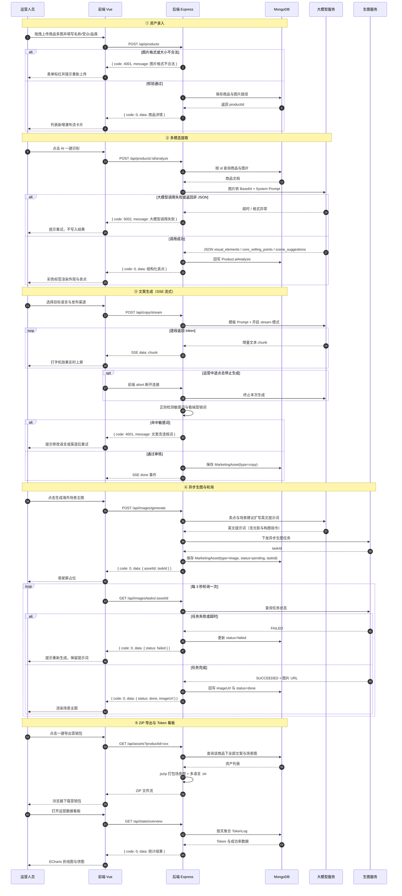

# 全栈业务流程图

> 绘制方式：Mermaid 时序图（VS Code 安装 “Markdown Preview Mermaid Support” 插件即可预览）。
> 主线四段：**资产录入 → 多模态提取 → 文案生成 → 生图导出**，并覆盖 3 个异常分支。

## 一、流程图

## 二、图说明

1. **五段主线**：资产录入阶段做格式与大小校验，非法上传直接拦截、不写库；多模态提取阶段由后端把图片转 Base64 并配合 System Prompt 强约束 JSON，结果回写 `Product.aiAnalysis`；文案生成阶段用 SSE 逐段推送，先落打字机效果再走敏感词拦截；生图阶段先扩写英文提示词，再下发异步任务并每 3 秒轮询；导出与看板阶段只读聚合文案与场景图打包下载，并按天聚合 `TokenLog` 出图。
2. **异常分支**共 4 处：图片格式/大小不合法返回 4001；大模型调用失败或返回非 JSON 返回 5002，前端提示重试且不写入结果；文案命中敏感词返回 4001，不入库；生图任务失败或超时把 `status` 置为 `failed`，保留提示词供重新生成。
3. **AI 请求只走后端**：前端不直接调用大模型与生图服务，所有调用经后端转发，由统一的 `llmClient` 记录 Prompt/Completion Tokens 与成功率，这是看板数据的来源。
4. **落库集中在后端三处**：商品入库、识别结果回写、文案与生图资产写入 `MarketingAsset`；前端刷新或重开页面后，历史素材都能从数据库恢复。
5. **接口自洽**：图中出现 7 个接口（`POST /api/products`、`POST /api/products/:id/analyze`、`POST /api/copy/stream`、`POST /api/images/generate`、`GET /api/images/tasks/:assetId`、`GET /api/assets`、`GET /api/stats/overview`），除 5 个核心接口外，其余在步骤 4 中作为“补充接口”列出，保证流程图与 API 规划能对上。

## 三、导出 PNG（可选）

1. 在 VS Code 中用 Mermaid 插件预览上图；
2. 右键预览面板选择导出 PNG，或使用 mermaid.live 粘贴代码后点击 Actions → PNG；
3. 把导出的 `业务流程图.png` 放到本目录，并在《项目需求规格与 API 规划书》中插入该图，图下附上第二节的文字说明。
