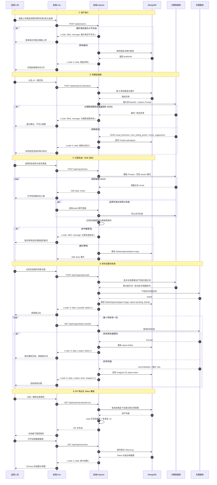

# 项目需求规格与 API 规划书

**多模态 AI 跨境电商智能出海营销工坊**

> 本文档为作业 1 的提交物，由步骤 1～4 的产出汇总而成：痛点分析、功能模块清单、业务流程图、API 接口规划。

## 一、项目概述

**背景**：中国品牌出海时，商品素材制作与海外社媒营销高度依赖人工——运营要人眼总结卖点、按语种与平台反复改写文案、请摄影师拍摄海外场景图，素材再散落在网盘与聊天记录里手工整理，AI 调用成本也不透明。

**目标用户**：跨境电商运营、独立站卖家与品牌出海团队中负责“商品上架与素材投放”的岗位。

**价值**：本系统把“看得懂商品、写得出多语言文案、做得出海外场景图、交得出打包素材”压缩为几步自动化操作——上传商品图后，AI 自动识别外观与卖点，按目标语言与渠道生成文案，异步生成海外场景主图，最后打包 ZIP 营销包并输出 Token 消耗看板，让素材产出周期从数天缩短到分钟级，同时把 AI 成本变成可控、可复盘的指标。

## 二、痛点分析

| 序号 | 痛点 | 具体表现（含场景举例） | 对运营的影响 | 可以用 AI 解决的方式 | 本系统解决模块 |
| :-: | --- | --- | --- | --- | --- |
| 1 | 商品靠人眼看，卖点口径不一 | 运营每天对着几十张商品图手工总结外观、材质、卖点。例如同一个便携榨汁杯在亚马逊写“随行便携”、在 TikTok 写“露营神器”，描述全凭人记 | 上架速度慢，卖点遗漏或前后矛盾，审核驳回率高 | 多模态大模型读图，输出结构化卖点 JSON（外观元素、核心卖点、场景建议） | 视觉理解 |
| 2 | 多语言文案靠外包，贵且慢 | 英、日、西每个语种都要单独找人写，日语敬语、西语语气各不相同。例如一家家居收纳品牌把英文机翻文案直接上架日本站，被买家吐槽“像说明书，没有购买欲” | 小语种市场拓展慢，外包费用高，文案转化率低 | Prompt 模板引擎 + 文本大模型，按目标语言一次性生成地道文案 | 文案引擎 |
| 3 | 平台调性各异，一条文案跨不了平台 | Amazon 要合规参数化描述，TikTok 要 15 秒口播脚本，Instagram 要 Emoji + Hashtag。例如团队把亚马逊长文案直接复制到 TikTok，播放量惨淡 | 一条素材只适配一个渠道，跨平台复用率极低，运营在多后台重复改写 | 按“语言 + 渠道”组合生成文案，自动带 Hashtag、Emoji 或脚本节奏，并做敏感词拦截 | 文案引擎 |
| 4 | 海外场景图拍摄贵、周期长 | 生活场景主图要摄影师、模特、场地。例如想在欧美家庭场景展示猫爬架，请摄影师拍摄整套图花了两周，费用抵掉一个月利润 | 新品上市周期被拉长，主图质量参差，投放素材数量受限 | 把卖点与场景建议扩写为英文生图提示词，调用生图大模型异步生成场景主图 | 场景生图 |
| 5 | 商品图片与信息散落各处，入库靠手工 | 原图在微信群、网盘、相册里各存一份，名称、受众、品类靠人工二次录入。例如运营为同一款商品重复建了三次档，图片版本还不一致 | 素材入口零散、命名混乱，后续查历史素材困难 | 多图拖拽上传 + 格式大小校验，商品信息与图片路径统一入库，瀑布流卡片集中管理 | 资产中心 |
| 6 | 投放素材交付靠人工收集打包 | 投放前要从网盘、文档、聊天记录里找齐图文再逐个改文件名。例如准备一次黑五投放，花两天从三处地方找齐 20 款商品图文 | 交付易漏件、易错版，返工频繁，错过投放排期 | 场景图与多语言文案（.txt）一键打包 ZIP，按商品与渠道自动归类下载 | 导出与看板 |
| 7 | AI 调用成本与失败率不透明 | 不清楚每天调了多少次模型、花了多少 Token、失败率多高，月底账单对不上。例如调试生图时写错循环，一晚重复调用上千次接口才发现 | 预算失控，无法判断哪些功能值得保留 | 统一 llmClient 埋点记录 Prompt/Completion Tokens 与成功率，ECharts 看板按天统计 | 导出与看板 |

> **提示**：表中场景为示例化描述，用于说明痛点类型，非真实统计数据。

## 三、功能模块清单

优先级定义：P0 = 必须做；P1 = 应该做；P2 = 有时间再做。

| **模块** | **功能点** | **优先级** | **对应作业** |
| -------- | ----------------------------------------------------- | ------- | --------- |
| 资产中心 | 多图拖拽上传、格式与大小校验、商品信息表单（名称/受众/品类）、瀑布流商品列表、素材检索与删除 | P0 | 作业 3 |
| 视觉理解 | AI 一键识别、System Prompt 约束纯 JSON 输出、外观/卖点/场景建议结构化展示、彩色标签渲染、结果回写商品 | P0 | 作业 4 |
| 文案引擎 | 目标语言与渠道选择、Prompt 模板引擎、敏感词与极端营销词拦截、SSE 流式打字机输出、文案历史管理 | P0 | 作业 5、6 |
| 场景生图 | 场景建议扩写英文提示词、异步生图任务下发、前端定时轮询任务状态、骨架屏占位与结果预览 | P0 | 作业 7 |
| 导出与看板 | ZIP 营销包打包（场景图 + 多语言 .txt）、Token 埋点记录、每日 Token 消耗折线图、API 成功率饼图 | P1 | 作业 8 |
| 工程与部署 | 前后端分层骨架、MongoDB 数据建模、多阶段构建 Dockerfile、docker-compose 服务编排、Nginx 反向代理与公网发布 | P0 | 作业 1、2、9、10 |

**扩展功能（有价值但本周不做，标为 P2）**

| **扩展功能** | **为什么暂不做** |
| ----------------------- | --------------------------------------------------------------------------- |
| 多用户登录与团队协作（账号体系、角色权限、素材共享） | 需要额外引入鉴权中间件与权限数据模型，会挤占本周围绕“上传→文案→生图→导出”主链路的开发时间，先把单人全流程跑通更有价值。 |
| 文案与场景图的历史版本对比、回滚 | 需要新增版本表与差异对比视图，属于体验优化而非核心链路；本周先保证素材能被生成并交付，版本管理留到后续迭代。 |

## 四、业务流程图



**图说明**

1. **五段主线**：资产录入阶段做格式与大小校验，非法上传直接拦截、不写库；多模态提取阶段由后端把图片转 Base64 并配合 System Prompt 强约束 JSON，结果回写 `Product.aiAnalysis`；文案生成阶段用 SSE 逐段推送，先落打字机效果再走敏感词拦截；生图阶段先扩写英文提示词，再下发异步任务并每 3 秒轮询；导出与看板阶段只读聚合文案与场景图打包下载，并按天聚合 `TokenLog` 出图。
2. **异常分支**共 4 处：图片格式/大小不合法返回 4001；大模型调用失败或返回非 JSON 返回 5002，前端提示重试且不写入结果；文案命中敏感词返回 4001，不入库；生图任务失败或超时把 `status` 置为 `failed`，保留提示词供重新生成。
3. **AI 请求只走后端**：前端不直接调用大模型与生图服务，所有调用经后端转发，由统一的 `llmClient` 记录 Prompt/Completion Tokens 与成功率，这是看板数据的来源。
4. **落库集中在后端三处**：商品入库、识别结果回写、文案与生图资产写入 `MarketingAsset`；前端刷新或重开页面后，历史素材都能从数据库恢复。
5. **接口自洽**：图中出现 7 个接口，除 5 个核心接口外，其余（`GET /api/images/tasks/:assetId`、`GET /api/assets`、`GET /api/stats/overview`）在第六节以“补充接口”列出。

## 五、技术选型

| **层次** | **技术选型** | **选型理由** |
| -------- | -------------------------------------------------- | ------------------------------------------------------------ |
| 前端 Web Client | Vue 3 + Vite + Element Plus + Pinia + ECharts | 组件化开发与响应式数据流开箱即用，Element Plus 覆盖表单、上传、卡片等本次高频组件，ECharts 直接满足 Token 看板需求。 |
| 后端 API Service | Node.js + Express | 与前端同为 JavaScript 生态，切换成本低；轻量路由便于按 routes/controllers/services 分层，且原生支持 SSE，实现流式文案最省事。 |
| 数据库 | MongoDB + Mongoose | 商品含多图数组与嵌套的 aiAnalysis 结构，文档模型天然适配，无需为新增字段做迁移；Mongoose 提供 Schema 校验，防止脏数据入库。 |
| 多模态大模型 | 通义千问 Qwen-VL（阿里云百炼） | 具备中文商品图的细节识别能力，可一次性输出外观、卖点、场景三类结构化结果，配合 System Prompt 能稳定返回 JSON。 |
| 文本大模型 | 通义千问 Qwen-Plus（兼容 OpenAI 协议） | 多语言与多渠道文案生成质量稳定，支持 stream 模式以配合 SSE 流式输出，同时兼容 OpenAI 协议，便于按额度替换模型。 |
| 生图大模型 | 通义万相（阿里云百炼） | 以异步任务方式生图，适合长耗时任务，避免 HTTP 请求超时；与识图、文案共用同一 API Key，配置链路最短。 |
| 云原生部署 | Linux + Docker + Docker Compose + Nginx | 容器化保证本地与云服务器环境一致；Compose 一条命令编排前端、后端与 MongoDB；Nginx 负责反向代理、静态资源与上传体积限制。 |

## 六、API 接口规划

### 6.1 统一响应格式

除 SSE 流式接口外，所有接口都返回下面的 JSON 结构，HTTP 状态码仅用于表达传输层结果，业务结果一律看 `code`：

```json
{
  "code": 0,          // 0 表示成功，非 0 表示失败
  "message": "ok",    // 失败时给出可读的错误原因
  "data": { }         // 业务数据，失败时可为空对象
}
```

### 6.2 错误码表

| **code** | **含义** | **典型触发条件** |
| -------- | -------- | ------------------------------------ |
| 0 | 成功 | 请求正常处理完成 |
| 4001 | 参数错误 | 缺少必填字段、类型不符、图片格式或大小不合法、命中敏感词 |
| 4004 | 资源不存在 | productId 在库中查不到对应商品 |
| 5001 | 服务器内部错误 | 图片写盘失败、MongoDB 写入失败、ZIP 打包失败 |
| 5002 | 大模型调用失败 | 模型超时、限流、鉴权失败、返回内容不是合法 JSON |
| 5003 | 生图任务失败 | 生图任务返回 FAILED、任务超时或结果图片下载失败 |

### 6.3 接口 1　商品创建与多图上传

| **项目** | **内容** |
| -------- | ---------------------------------------------------------------------- |
| 接口名称 | 创建商品并上传图片 |
| 请求方式与路径 | POST /api/products |
| 请求参数 | multipart/form-data：表单字段 + 图片文件 |
| 成功响应 | { "code": 0, "message": "ok", "data": { 商品对象 } } |
| 失败响应 | { "code": 4001, "message": "图片格式不合法" }、{ "code": 5001, "message": "图片保存失败" } |
| 说明 | 后端先校验图片与必填字段，再写盘并入库；图片只存相对路径，返回体里带回完整商品对象 |

**入参**

| **参数名** | **类型** | **必填** | **含义** |
| -------- | --------- | ------ | ------------------------------- |
| name | string | 是 | 商品名称，1～50 字 |
| audience | string | 否 | 目标受众，如“25-35 岁露营人群” |
| category | string | 否 | 品类，如“户外用品” |
| images | file[] | 是 | 商品图片，1～6 张，仅 jpg/png/webp，单张不超过 5MB |

**出参**

| **字段名** | **类型** | **含义** |
| ----------------- | ---------- | ----------------------- |
| code | number | 0 表示成功 |
| data.\_id | string | 商品 ID，后续所有接口都用它 |
| data.name | string | 商品名称 |
| data.audience | string | 目标受众 |
| data.category | string | 品类 |
| data.images | string[] | 图片相对路径数组，如 /uploads/xxx.png |
| data.aiAnalysis | object | 创建时为 null，由接口 3 回写 |
| data.createdAt | string | 创建时间，ISO 8601 |

**失败情形**

| **code** | **message** | **触发条件** |
| -------- | -------------- | --------------------- |
| 4001 | 商品名称不能为空 | 缺少 name 字段 |
| 4001 | 图片格式不合法 | 出现 jpg/png/webp 以外的文件 |
| 4001 | 图片超过大小限制 | 单张图片大于 5MB |
| 5001 | 图片保存失败 | 磁盘写入异常 |

### 6.4 接口 2　商品列表查询

| **项目** | **内容** |
| ------- | ------------------------------------------------------------ |
| 接口名称 | 查询商品列表 |
| 请求方式与路径 | GET /api/products |
| 请求参数 | Query 参数：分页、关键词、品类 |
| 成功响应 | { "code": 0, "data": { "list": [ 商品对象 ], "total": 32, "page": 1 } } |
| 失败响应 | { "code": 4001, "message": "pageSize 超出上限" }、{ "code": 5001, "message": "查询商品失败" } |
| 说明 | 按 createdAt 倒序返回，供前端瀑布流卡片渲染；只返回列表所需字段，不带大字段全文 |

**入参**

| **参数名** | **类型** | **必填** | **含义** |
| --------- | ------- | ------ | ------------------------- |
| page | number | 否 | 页码，默认 1 |
| pageSize | number | 否 | 每页条数，默认 12，上限 50 |
| keyword | string | 否 | 按商品名称模糊搜索 |
| category | string | 否 | 按品类过滤 |

**出参**

| **字段名** | **类型** | **含义** |
| --------------------- | -------- | ------------------- |
| data.list | array | 商品数组，元素字段同接口 1 的 data |
| data.list[].images | string[] | 图片路径数组，卡片取第一张作封面 |
| data.total | number | 符合条件的总条数 |
| data.page | number | 当前页码 |

**失败情形**

| **code** | **message** | **触发条件** |
| -------- | ------------ | --------------- |
| 4001 | pageSize 超出上限 | pageSize 大于 50 |
| 4001 | 分页参数非法 | page 或 pageSize 非数字 |
| 5001 | 查询商品失败 | MongoDB 查询异常 |

### 6.5 接口 3　AI 识别商品外观与卖点

| **项目** | **内容** |
| ------- | -------------------------------------------------------------------------------------------------------------------------- |
| 接口名称 | AI 识别商品外观与卖点 |
| 请求方式与路径 | POST /api/products/:id/analyze |
| 请求参数 | 路径参数 id：商品 ID（字符串，必填）；可选 imageIndex |
| 成功响应 | { "code": 0, "data": { "visual\_elements": \["..."], "core\_selling\_points": \["..."], "scene\_suggestions": \["..."] } } |
| 失败响应 | { "code": 4004, "message": "商品不存在" }、{ "code": 5002, "message": "大模型返回格式异常" } |
| 说明 | 后端读取图片并转 Base64，调用多模态模型；结果写回 Product.aiAnalysis；同步接口，前端需 loading，超时 60s |

**入参**

| **参数名** | **类型** | **必填** | **含义** |
| ------- | ------ | ------ | ------------- |
| id | string | 是 | 路径参数，商品 ID |
| imageIndex | number | 否 | 指定分析的图片序号，默认 0 |

**出参**

| **字段名** | **类型** | **含义** |
| -------------------- | -------- | ----------------------------- |
| data.productId | string | 商品 ID |
| data.visual\_elements | string[] | 外观元素，如材质、颜色、形状 |
| data.core\_selling\_points | string[] | 核心卖点，用于后续文案与生图提示词 |
| data.scene\_suggestions | string[] | 场景建议，作为生图扩写的输入 |
| data.analyzedAt | string | 识别完成时间 |

**失败情形**

| **code** | **message** | **触发条件** |
| -------- | ------------- | ---------------------- |
| 4004 | 商品不存在 | id 在库中查不到 |
| 4001 | 商品图片为空 | 商品没有已上传的图片 |
| 5002 | 大模型调用失败 | 超时、限流或鉴权失败 |
| 5002 | 大模型返回格式异常 | 返回内容不是合法 JSON，无法解析三个字段 |

### 6.6 接口 4　多语言文案流式生成

| **项目** | **内容** |
| ------- | ----------------------------------------------------------------- |
| 接口名称 | 按语言与渠道流式生成营销文案 |
| 请求方式与路径 | POST /api/copy/stream |
| 请求参数 | JSON Body：商品 ID、目标语言、发布渠道 |
| 成功响应 | SSE 流，逐段推送文本；结束时推送 done 事件 |
| 失败响应 | 流建立前：{ "code": 4004, "message": "商品不存在" }；流建立后：error 事件带 code 与 message |
| 说明 | 响应头 Content-Type: text/event-stream、Cache-Control: no-cache；前端用 fetch + ReadableStream 读取，支持中途 abort |

**入参**

| **参数名** | **类型** | **必填** | **含义** |
| ----------- | ------- | ------ | ------------------------------------------- |
| productId | string | 是 | 商品 ID |
| language | string | 是 | 目标语言，枚举 en / ja / es |
| channel | string | 是 | 发布渠道，枚举 amazon / tiktok / instagram |
| extraPrompt | string | 否 | 附加要求，如“突出防水性能” |

**出参（SSE 事件）**

| **事件与字段** | **类型** | **含义** |
| ------------------ | ------ | ----------------------------- |
| event: chunk | object | { "delta": "增量文本" }，可能推送多次 |
| event: done | object | { "code": 0, "data": { "assetId": "..." } }，文案已入库 |
| event: error | object | { "code": 5002, "message": "生成中断" } |

**失败情形**

| **code / 事件** | **message** | **触发条件** |
| ------------- | ------------ | -------------------- |
| 4004 | 商品不存在 | productId 查不到，流未建立时返回 |
| 4001 | 文案含违规词 | 命中敏感词或极端营销词，拒绝入库 |
| error 事件 5002 | 文案生成失败 | 模型超时或连接中断 |
| error 事件 4999 | 客户端已断开 | 运营点击“停止生成”后前端 abort |

### 6.7 接口 5　海外场景主图生成

| **项目** | **内容** |
| ------- | --------------------------------------------------------------------------------- |
| 接口名称 | 生成海外场景主图（异步任务） |
| 请求方式与路径 | POST /api/images/generate |
| 请求参数 | JSON Body：商品 ID、场景建议、风格 |
| 成功响应 | { "code": 0, "data": { "assetId": "...", "taskId": "...", "status": "pending", "prompt": "英文提示词" } } |
| 失败响应 | { "code": 5002, "message": "提示词扩写失败" }、{ "code": 5003, "message": "生图任务下发失败" } |
| 说明 | 先用文本模型把卖点与场景建议扩写为英文提示词；再向生图服务下发异步任务；前端每 3 秒轮询任务状态 |

**入参**

| **参数名** | **类型** | **必填** | **含义** |
| --------------- | ------ | ------ | ----------------------------------------- |
| productId | string | 是 | 商品 ID |
| sceneSuggestion | string | 否 | 场景建议，默认取 Product.aiAnalysis.scene\_suggestions\[0\] |
| style | string | 否 | 风格，枚举 lifestyle / studio / outdoor，默认 lifestyle |

**出参**

| **字段名** | **类型** | **含义** |
| ------------- | ------ | ----------------------------- |
| data.assetId | string | 营销资产 ID，轮询时作为路径参数 |
| data.taskId | string | 生图服务返回的任务 ID，用于排查问题 |
| data.status | string | 任务状态，下发成功即为 pending |
| data.prompt | string | 后端扩写后的英文提示词，便于调试与截图 |

**失败情形**

| **code** | **message** | **触发条件** |
| -------- | ------------ | -------------------- |
| 4004 | 商品不存在 | productId 查不到 |
| 4001 | 场景建议为空 | 未传 sceneSuggestion 且商品尚未 AI 识别 |
| 5002 | 提示词扩写失败 | 文本模型调用失败 |
| 5003 | 生图任务下发失败 | 生图服务不可用或额度不足 |

### 6.8 补充接口

以下接口在业务流程图中出现，但不占用 5 个核心接口名额，作为作业 2～8 实现时的参考：

| **接口** | **作用** | **对应作业** |
| ------------------------------ | -------------- | -------- |
| GET /api/health | 健康检查，联调用 | 作业 2 |
| POST /api/copy/generate | 同一文案能力的非流式版本 | 作业 5 |
| GET /api/images/tasks/:assetId | 轮询生图任务状态 | 作业 7 |
| GET /api/assets | 按商品查询文案与图片资产 | 作业 6、8 |
| GET /api/stats/overview | Token 消耗与 API 成功率统计 | 作业 8 |

## 七、本周开发计划

| **日期** | **主题** | **当日产出** | **对应作业** |
| -------- | --------------------- | ------------------------------------------------- | --------- |
| 周一 | 需求架构与全栈骨架搭建 | 本文档（需求与 API 规划书）、前后端联调成功的工程骨架 | 作业 1、2 |
| 周二 | 资产中心与多模态视觉理解 | 商品上传与瀑布流列表、AI 一键识别卖点 | 作业 3、4 |
| 周三 | 文案生成引擎与 SSE 流式交互 | 多语言多渠道文案、打字机流式效果与敏感词拦截 | 作业 5、6 |
| 周四 | AI 场景生图与数据看板统计 | 场景主图、ZIP 营销包、Token 消耗看板 | 作业 7、8 |
| 周五 | 容器化云部署与项目交付 | 公网可访问的系统、README、录屏与总结报告 | 作业 9、10 |
